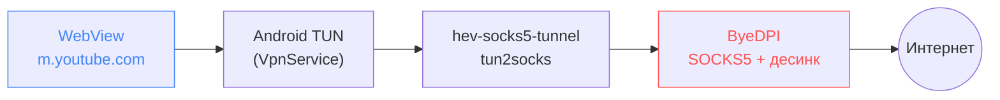

<div align="center">

# 📺 YouTube VoT

**Лёгкий Android-клиент YouTube без обязательного входа в Google-аккаунт, с фильтрацией рекламы и закадровым переводом на русский язык.**

[](https://github.com/Erzkanzler2k/youtube-vot/releases/latest)
[](https://github.com/Erzkanzler2k/youtube-vot/actions/workflows/build-release.yml)
[](#-совместимость-и-ограничения)
[](#-установка)
[](#-приватность-и-разрешения)

YouTube VoT открывает мобильную версию YouTube во встроенном WebView и добавляет
в неё закадровый перевод. Не требует root, Google-сервисов или отдельной регистрации.

</div>

---

## ✨ Возможности

**Просмотр и контент**
- 🚫 **Без входа в Google** — YouTube работает без аккаунта; история не пишется в Google.
- 🇷🇺 **Закадровый перевод** — русская озвучка видео на базе [voice-over-translation](https://github.com/ilyhalight/voice-over-translation).
- 🌍 **Страна контента** — выбор региона рекомендуемых видео.
- 🧹 **Сброс рекомендаций** — очистка cookies и кэша YouTube одним тапом.

**Управление**
- 🔍 **Поиск** — полноценный поиск по YouTube без браузера.
- 🔗 **Поделиться чистой ссылкой** — ссылка без трекинговых параметров (`&feature`, `&pp` и т.п.).
- 🖼️ **Картинка-в-картинке** — видео продолжает играть в уголке экрана при уходе из приложения.
- 🎧 **Фоновое воспроизведение** (опционально) — MediaSession-карточка с паузой, перемоткой и переключением треков при свёрнутом приложении и заблокированном экране.

**Сеть**
- 🛰️ **Обход DPI-блокировок** (опционально) — встроенный транспорт ByeDPI + tun2socks с измеряемым выбором стратегии (см. [обход блокировок](#-обход-блокировок-dpi)).
- ⬆️ **Автообновление** — проверка новых релизов на GitHub с проверкой версии и подписи.

---

## 📥 Установка

[](https://github.com/Erzkanzler2k/youtube-vot/releases/latest)

APK публикуются в разделе [Releases](https://github.com/Erzkanzler2k/youtube-vot/releases).
Зеркало последнего релиза (jsDelivr, без регистрации):

```
https://cdn.jsdelivr.net/gh/Erzkanzler2k/youtube-vot@v2.7.1/out/YouTubeVot.apk
```

1. Скачайте `YouTubeVot.apk` из Releases или по зеркалу.
2. Откройте APK через файловый менеджер.
3. Разрешите установку из этого источника, если Android спросит.
4. Запустите YouTube VoT.

> [!NOTE]
> Play Protect может предупреждать о приложениях, установленных из APK.
> Устанавливайте только APK из официального репозитория проекта.

### Обновление

Приложение само проверяет новые релизы и предлагает обновление (можно отключить в настройках). Релизы подписаны постоянным release-ключом, поэтому обновление ставится поверх предыдущей версии без удаления. Поверх версии старше **2.7.0** (подпись сменилась) нужно один раз удалить приложение и установить v2.7.1+ заново.

Текущая версия: **2.7.1**.

---

## ⚙️ Настройки

Открываются шестерёнкой в нижней панели:

| Настройка | Что делает |
|---|---|
| **Страна контента** | Выбор страны рекомендуемого контента |
| **Сбросить рекомендации** | Cookies YouTube, кэш WebView и перезагрузка страницы; настройки VoT сохраняются |
| **Фоновое воспроизведение** | Foreground-сервис + MediaSession-управление звуком в фоне |
| **Обход блокировок (VPN)** | Необязательный сетевой транспорт для восстановления доступа к YouTube |
| **Сервер перевода** | Адрес собственного воркера перевода VoT |
| **Автообновление** | Включить/отключить проверку новых версий |
| **Проверить обновления** | Ручная проверка релизов |
| **Сбросить настройки** | Возврат к значениям по умолчанию |

---

## 🎧 Фоновое воспроизведение и «Картинка-в-картинке»

- С включённым фоновым воспроизведением звук продолжает играть в фоне и управляется системной MediaSession-карточкой.
- Без него звук **глохнет при сворачивании** — все видео на странице ставятся на паузу при уходе приложения в фон.
- Полноэкранное видео при выходе из приложения сворачивается в окно PiP и продолжает играть.

---

## 🛰️ Обход блокировок (DPI)

Необязательный транспорт на базе нативного [ByeDPI](https://github.com/hufrea/byedpi) и
[hev-socks5-tunnel](https://github.com/heiher/hev-socks5-tunnel). Включается отдельно
в настройках и использует системный `VpnService`.



**Стратегия выбирается измерением, а не конфигом.** При старте: быстрый замер
текущей стратегии → лестница из двух дешёвых проверок → полный перебор каталога
стратегий (только он остывает). Побеждает наименьшая медиана по худшему хосту из
четырёх стабильных узлов YouTube. Замер ведёт изолированный процесс — сам
приложение из туннеля исключено, чтобы не зациклить локальный прокси. Подробности
и все оговорки — в [BYPASS.md](BYPASS.md).

Это **не VPN-провайдер и не сервис анонимности**:

- IP-адрес не меняется, трафик не шифруется дополнительно;
- доступ к заблокированным ресурсам не гарантируется — результат зависит от
  оператора, провайдера и настроек DPI;
- UDP выключен намеренно: byedpi десинхронизирует только TLS, а YouTube в WebView
  пробует QUIC — открытый UDP даёт «зелёный тест» и чёрный экран.

> [!WARNING]
> Транспорт использует `VpnService`: собственный трафик приложения исключён из
> туннеля, но остальной трафик телефона может в него попадать. Не включайте
> обход, если это нежелательно.

---

## 🌐 Перевод

В приложение встроен [voice-over-translation](https://github.com/ilyhalight/voice-over-translation).

Если перевод не запускается:

1. Проверьте подключение к интернету.
2. Откройте настройки сервера перевода.
3. Укажите адрес собственного воркера, если он у вас есть.
4. Перезапустите страницу видео.

---

## 🔒 Приватность и разрешения

Приложение:

- не требует входа в Google-аккаунт и не собирает историю просмотров в Google;
- хранит cookies и локальные данные WebView только на устройстве;
- использует интернет только для YouTube, перевода, обновлений и выбранного сетевого транспорта;
- не является официальным приложением YouTube или Google LLC.

Системное разрешение VPN запрашивается только при включении обхода и может быть отозвано в настройках Android.

---

## 🤝 Совместимость и ограничения

- Android **7.0 (API 24)+**, цель — **API 35**.
- Архитектуры: `armeabi-v7a`, `arm64-v8a`, `x86`, `x86_64`.
- Некоторые защищённые видео, покупки, трансляции и функции аккаунта могут не работать.
- YouTube периодически меняет HTML и правила показа рекламы — отдельные элементы иногда просачиваются.
- YouTube может запросить проверку или показать CAPTCHA.
- Обход DPI зависит от оператора и не является гарантией доступности.

---

## 🛡️ Безопасность APK

Релизные APK подписываются постоянным release-ключом в CI (пайплайн
`ndk-build → aapt2 → javac → d8 → ZipFix → zipalign → apksigner`). Ключ подписи не
хранится в репозитории и не публикуется. Не передавайте keystore и пароли от него
третьим лицам.

---

## 🧱 Сборка из исходников

```bash
git clone --recurse-submodules https://github.com/Erzkanzler2k/youtube-vot
cd youtube-vot
powershell -ExecutionPolicy Bypass -File build.ps1
```

Требования: JDK 17, Android SDK (`build-tools 34.0.0` + `platform android-35`),
Android NDK (для нативного транспорта). Готовый APK: `out/YouTubeVot.apk`.

CI собирает релизы автоматически: пуш тега `v*` запускает [сборку и публикацию
Release](.github/workflows/build-release.yml) с подписанным APK; `workflow_dispatch`
— только сборка для проверки.

Структура:

```
src/java/com/vot/youtube/   # MainActivity, сервисы, обход, обновления
src/cpp/                    # byedpi + hev-socks5-tunnel (pinned submodules)
src/assets/vot/             # bootstrap.js (shims) + userscript VoT
src/res/                    # ресурсы
tools/ZipFix.java           # нормализация ZIP-путей APK
build.ps1                   # ручной пайплайн сборки
BYPASS.md                   # подробности конструкции обхода
```

---

## 🙏 Благодарности

- [voice-over-translation](https://github.com/ilyhalight/voice-over-translation) — закадровый перевод.
- [ByeDPI](https://github.com/hufrea/byedpi) — десинхронизация DPI-трафика (MIT).
- [hev-socks5-tunnel](https://github.com/heiher/hev-socks5-tunnel) — tun2socks-транспорт (MIT).

---

## ⚠️ Дисклеймер

YouTube VoT — неофициальный клиент. Проект не связан с YouTube, Google LLC,
Яндексом и авторами перечисленных выше проектов. Использование приложения и
доступ к YouTube регулируются условиями сервиса и применимым законодательством
вашей страны. Пользователь самостоятельно отвечает за соблюдение правил сервисов,
авторских прав и сетевых ограничений.
